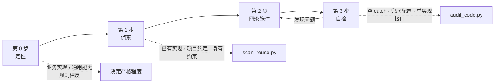

# 克制的代码 · code-discipline

> **AI 写的代码，为什么越写越不敢动？**
>
> 一个约束 AI「重复造轮子 / 无差别防御 / 提前抽象 / 结构不自明」的 Agent Skill。

*An agent skill that keeps AI-written code from reinventing utilities, over-defending, over-abstracting, and becoming unreadable.*

---

## 问题

AI 生成的代码，单独看每一行都没错，放在一起就没人敢碰。常见四种退化：

| 症状 | 表现 |
|---|---|
| **重复造轮子** | 通用能力被塞进业务模块，命名和位置都绑死业务，同样的功能在多个模块各写一遍 |
| **无差别防御** | 到处判空、到处 `try-catch`、配置读不到就给默认值，问题被"兜"住而不是被暴露 |
| **提前抽象** | 只有一个实现，却先抽出 interface + Factory + Strategy，"方便以后扩展" |
| **结构不自明** | 辅助方法、中间变量、边界判断层层堆叠，主线被埋掉；删任何一处都怕出事 |

它们看起来矛盾——一边重复造轮子，一边又过度设计——但病因是同一个：

> **用局部上下文做全局决策。**

看不见项目里已有的实现 → 重造；不知道校验和异常的责任边界在哪 → 全防；不确定未来会不会变 → 先抽象；无法确认影响范围 → 层层包裹。

所以这个 skill 的主线不是"写得更优雅"，而是：**先扩大上下文，再缩小改动面。**

## 它怎么工作



**第 0 步 · 定性**：先判定这是"业务实现"还是"通用能力"。两类任务规则相反——业务代码里抽象越少越好，工具库里才值得投入接口设计。判错方向的代价不对称。

**第 1 步 · 侦察**：写第一行代码之前，查三件事——已有实现、项目约定、既有约束（全局异常处理器、校验框架、ORM 非空约束）。查完必须先输出一句结论再动手。

**第 2 步 · 四条铁律**：复用优先于新建；只在校验入口校验；抽象等第三次；主线优先。

**第 3 步 · 自检**：跑脚本，再回答五个问题。答不上来的项就是要改的项。

## 目录结构

```
code-discipline/
├── SKILL.md                    # 主文件：定性 → 侦察 → 铁律 → 自检 → 红线
├── references/
│   ├── reuse.md                # 按能力搜的词表、吻合度判定树、代码该放哪一层
│   ├── boundaries.md           # 信任边界矩阵、异常分层、配置 fail-fast、日志分层
│   └── shape.md                # 抽象决策树、层数预算、重构前后对照、坏味道速查
├── scripts/
│   ├── scan_reuse.py           # 按能力词扫仓库里已有的实现
│   └── audit_code.py           # 扫空 catch / 兜底配置 / 单实现接口 / 长函数
├── README.md
└── LICENSE
```

主文件控制在 150 行内，详细规则拆到 `references/`，只在对应卡点按需加载——避免 skill 自己变成一个"过度设计"的样本。

## 安装

任何遵循 `SKILL.md` 约定的 Agent 都可以直接用（Claude Code、Codex CLI、WorkBuddy 等）。

```bash
git clone <this-repo> code-discipline

# 用户级：所有项目可用
cp -r code-discipline ~/.workbuddy-ai/skills/     # WorkBuddy
cp -r code-discipline ~/.claude/skills/           # Claude Code

# 项目级：只对当前仓库生效
cp -r code-discipline <your-repo>/.workbuddy-ai/skills/
```

重启 Agent 后生效。

## 两个脚本

### `scan_reuse.py` —— 解决"看不见已有实现"

"先搜索已有实现"这条规则本身没用：AI 往往用自己准备新建的名字去搜，当然搜不到。所以按**能力**搜，不按名字搜。

```bash
python scripts/scan_reuse.py ./src --terms "format,date"
```

```text
Scanned 2 files under ./src
Terms: format, date

  0.90  formatDate       common/date.ts:1
        export function formatDate(d: Date, pattern = 'YYYY-MM-DD'): string {
  0.90  parseDate        common/date.ts:5
        export const parseDate = (s: string): Date => new Date(s);
  0.90  formatOrderDate  service/order.ts:18
        export function formatOrderDate(d: Date) { return formatDate(d); }

Shared dirs worth reading before deciding to write new code:
  common
```

最后一条正是要拦的典型：`formatOrderDate` 只是 `formatDate` 的业务改名版，而 `formatDate` 就在旁边的 `common/` 里。

支持 Python / TypeScript / JavaScript / Vue / Svelte / Go / Java / Kotlin / C# / Scala / Rust / PHP / Ruby，按 camelCase / snake_case 分词后做相似度打分。

### `audit_code.py` —— 交付前自检

```bash
python scripts/audit_code.py ./src/service/order.ts
```

```text
Audited 1 files, 3 hint(s).
Hints are questions, not verdicts. Answer each one or change the code.

src/service/order.ts
  L11    swallowed-exception    catch 后只打日志，错误不再向上传播
         logger.error(e)
  L14    silent-default         必填配置带兜底值：process.env.X || fallback
         const secret = process.env.JWT_SECRET || 'dev-secret';

Abstractions
  src/service/order.ts:3  PaymentGateway：只有 1 个实现（order.ts:7），确认是否真的需要抽象
```

四类检测：空 catch / 只打日志的 catch、环境变量兜底、单实现接口、超过 80 行的函数。

**它是提示生成器，不是 linter。** 每条命中都是一个要回答的问题——`except: pass` 有时是合理的（比如尽力关闭文件句柄）。脚本负责让可疑的行可见，判断仍然由人做。

## 四条铁律

### 1. 复用优先于新建

- 吻合度 ≥70% → 扩展现有实现（加可选参数、加重载）
- 30–70% → 新建，但放公共层，命名不带业务词
- 业务模块内只允许存在"仅服务这一个业务"的私有函数

**判定口诀**：把函数名里的业务词删掉，如果还说得通 → 属于公共层。`formatOrderDate` 删掉 `Order` 还是 `formatDate`，说明业务词是多余的。

### 2. 只在信任边界校验

校验一次，之后信任契约。信任边界 = 外部输入进入系统的那一圈：HTTP 入参、MQ 消息、第三方回调、文件上传、配置加载。数据库若已声明非空，读出来就不必再判。

判断一个默认值是否合法，只问一句：**这个默认值被用上时，系统行为还是正确的吗？** `pageSize` 默认 20 是对的，`JWT_SECRET` 默认 `'dev-secret'` 等于没有鉴权。

### 3. 抽象等第三次

- 第 1 次：直接写
- 第 2 次：允许复制，留一行 `// 与 xxx 重复，第三次出现时提取`
- 第 3 次：提取，此时才知道真正的变化点在哪

抽象只有三个合法来源：真实重复、真实变化、外部集成点（需要 mock 测试）。三条都不满足，就是提前抽象——问题不是多写了代码，而是**猜错了变化的方向**。

### 4. 主线优先

读代码的人应该能从上往下读完主流程，不用来回跳转十次。

- 一个函数只做一个抽象层级的事
- 主流程缩进超过 3 层 → 抽"步骤函数"，函数名说清做什么（`applyDiscount`），不是怎么做（`loopAndMultiply`）
- 用早返回代替嵌套
- 注释写 why，不写 what
- 删掉某个辅助方法后主流程仍读得懂 → 它本来就该内联

## 设计取舍

**只写可执行判据，不写最佳实践口号。** 每条规则都配一个能回答的问题：

| 规则 | 判断问题 |
|---|---|
| 复用 | 这个函数项目里是不是已经有人写过？ |
| 防御 | 这个判空防的是哪个**真实存在**的空值来源？ |
| 抽象 | 把这个接口删掉，代码变短还是变长？变短就删 |
| 自明 | 把这三个辅助方法删掉，主流程还读得懂吗？ |

**明确写了"四条铁律是默认值，不是教条"。** 否则这个 skill 会变成新的教条——用户要对外 SDK 时它还在喊"别抽象"。要避免的是"没有理由的默认动作"，不是"有理由的例外"。

**区分业务实现与通用能力。** 这是整套规则的枢纽：同一个动作，在业务代码里是过度设计，在工具库里是必要投入。

**分层加载。** 主文件只留决策路径，细节拆到三份 reference，按当前卡点选读。

**为什么不直接用 ESLint / SonarQube？** 静态检查擅长识别语法层面的坏味道，但识别不了这三个问题：这个函数项目里是不是已经有人写过（要跨文件搜索）、这个接口有没有第二个实现（要跨模块统计）、这段代码的主线还在不在（要理解意图）。这三件事需要上下文和判断，恰好是 Agent 的强项——所以约束应该写在 Agent 的行为规则里，而不是写在 lint 规则里。两者不冲突：lint 管风格，这个 skill 管决策。

## 适用范围

**适合**：在已有代码库里加功能、改业务逻辑、写工具函数、重构、review diff、纠结"要不要抽接口 / 要不要加校验 / 要不要 catch"。

**不适合**：一次性脚本、单文件 demo、原型；或需要完整架构设计的新项目。

**它是横向约束，不替代技术栈 skill。** 和 `fullstack-dev` 这类 skill 同时生效时，架构骨架听技术栈 skill，代码粒度听这个。

## 局限

- `audit_code.py` 是启发式的，会有漏报和误报；它不做类型分析，不理解业务语义
- `scan_reuse.py` 按名字匹配，命名风格差异过大时可能找不到（这也是为什么它同时输出"值得一读的公共目录"）
- 规则的效果取决于 Agent 是否真的先读代码再动手——这一点无法用脚本强制

## License

MIT
